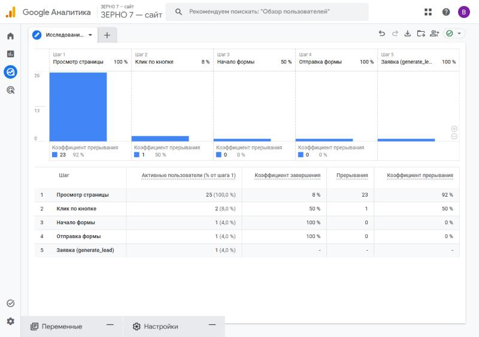
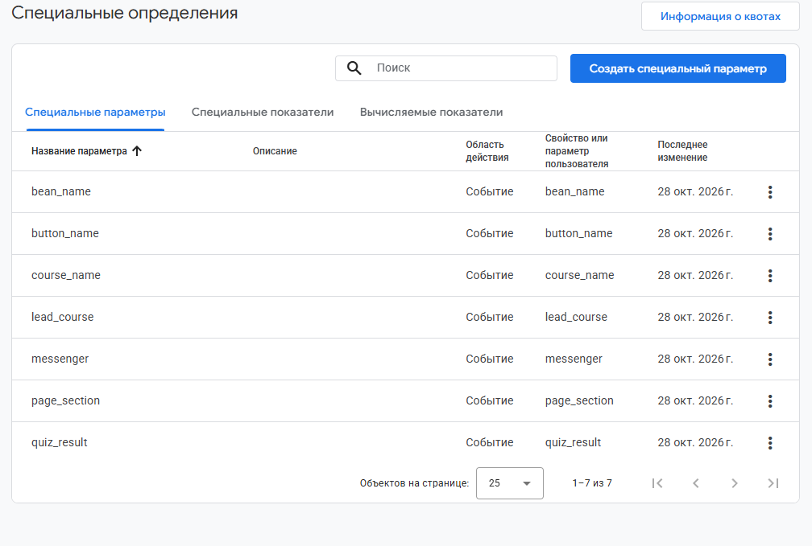
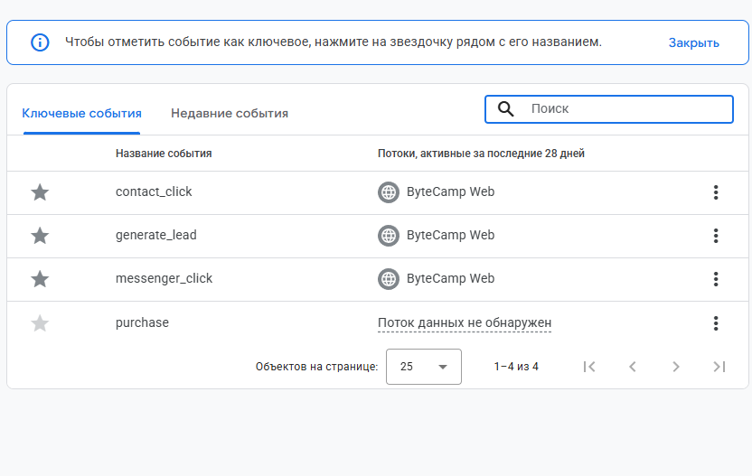

# Занятие 2. Воронка бизнеса и структура GA4

| Поле | Значение |
|---|---|
| Студент | Абдуллаев Билолиддин Низомидинович |
| Группа | 9/2-РПО-25/3 |
| Дисциплина | ОП.03 «Информационные технологии» |
| Работа | Домашняя работа № 2 |

Бизнес — школа бариста при кофейне **«Зерно 7»**, мой учебный проект ТЗ-02/2026: [сайт](https://bilolabd2009-lab.github.io/Information-Technology-Homework/tz-02-kofeynya-zerno7/), [исходники](../../tz-02-kofeynya-zerno7/).

## 1. Воронка бизнеса

Путь клиента от первого касания до оплаты курса:

| Шаг | Где происходит | Чем измеряется |
|---|---|---|
| 1. Увидел публикацию | Instagram, ВКонтакте, Telegram, YouTube, блогеры, QR на стакане | ссылки с UTM-метками U-01…U-12 |
| 2. Зашёл на сайт | любая из 9 страниц | `page_view` |
| 3. Заинтересовался курсом | карточка курса, тест, выбор потока | `view_course`, `quiz_complete`, `select_course_date` |
| 4. Нажал «Записаться» | кнопки заявки | `cta_click` |
| 5. Заполнил форму | форма `lead-form` | `form_start`, `form_submit` |
| 6. Оставил заявку | заявка записана в таблицу | `generate_lead` (ключевое событие) |
| 7. Оплатил курс | менеджер меняет статус в таблице | `status = paid` в листе `leads` |

Реальная воронка в GA4 (закрытая, 27–29.10.2026, данные тестовые):

| Шаг | Пользователи | % от шага 1 |
|---|---|---|
| Просмотр страницы | 25 | 100 % |
| Клик по кнопке (`cta_click`) | 2 | 8 % |
| Начало формы | 1 | 4 % |
| Отправка формы | 1 | 4 % |
| Заявка (`generate_lead`) | 1 | 4 % |

Больше всего людей теряется между просмотром страницы и кликом по кнопке: 92 %.

## 2. Структура GA4

| Уровень | Что у меня |
|---|---|
| Аккаунт | Абдуллаев Билол |
| Ресурс | «ЗЕРНО 7 — сайт», часовой пояс GMT+03:00 Москва, валюта RUB |
| Поток данных | Web, идентификатор `G-QKNW25FRB5`, включена расширенная статистика: прокрутка, внешние ссылки, формы, скачивания |
| Пользовательские параметры | 7 штук с областью «Событие»: `button_name`, `page_section`, `course_name`, `quiz_result`, `lead_course`, `bean_name`, `messenger` |
| Ключевые события | `generate_lead`, `contact_click`, `messenger_click` |

Подробно настройка описана в [docs/setup.md](../../tz-02-kofeynya-zerno7/docs/setup.md), раздел 2.
