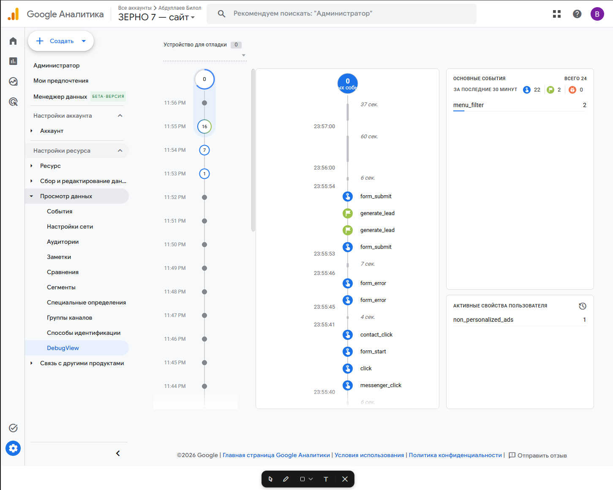
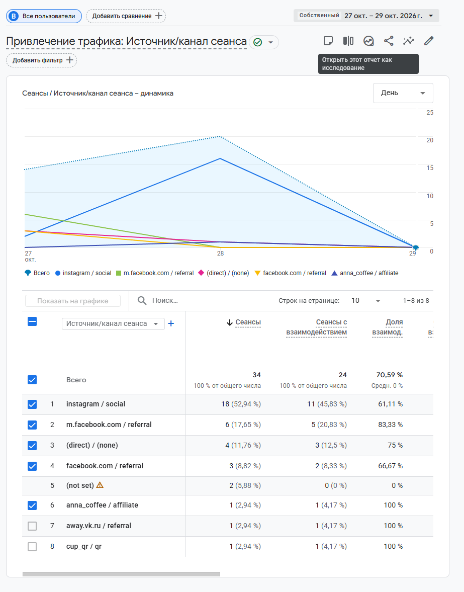

# Занятие 3. Google Tag, подключение GA4 и источники переходов

| Поле | Значение |
|---|---|
| Студент | Абдуллаев Билолиддин Низомидинович |
| Группа | 9/2-РПО-25/3 |
| Дисциплина | ОП.03 «Информационные технологии» |
| Работа | Домашняя работа № 3 |

## Часть 1. Сравнение сайтов

Полный отчёт: [lessons_3.pdf](../homework/lessons_3.pdf). В нём я сравниваю свой стенд [stand/index.html](../stand/index.html) с Google Merch Shop и IKEA по аналитике, воронке и приватности.

| Признак | Мой стенд | Google Merch Shop | IKEA |
|---|---|---|---|
| Доменов в запросах при загрузке | 0 внешних | 20 | 3 |
| Системы аналитики | своя имитация | 8 счётчиков GA4 + UA, Google Ads, DoubleClick и др. | до согласия ни одной |
| Cookie-баннер | нет | есть, но счётчики работают без ответа | есть, трекеры ждут ответа |

## Часть 2. Google Tag на моём сайте

На всех 9 страницах сайта «Зерно 7» в `<head>` подключён тег `googletagmanager.com/gtag/js?id=G-QKNW25FRB5`. Проверить это можно через `Ctrl+U` на любой странице. Режим отладки в коде выключен, он включается расширением Google Analytics Debugger.

## Часть 3. Источники переходов (UTM)

Я составил реестр из 12 ссылок с метками `utm_source`, `utm_medium`, `utm_campaign`, `utm_content` и `utm_term`: [docs/utm.csv](../../tz-02-kofeynya-zerno7/docs/utm.csv).

| № | Канал | source / medium | content |
|---|---|---|---|
| U-01 | Instagram, шапка профиля | instagram / social | bio |
| U-02 | Instagram, автоответ «ЛАТТЕ» | instagram / social | reel_latte_01 |
| U-05 | ВКонтакте, пост | vk / social | post_01 |
| U-07 | Telegram, пост | telegram / social | post_01 |
| U-09 | YouTube, описание видео | youtube / social | video_grind_01 |
| U-10 | Блогер | anna_coffee / affiliate | review_01 |
| U-12 | QR-код на стакане | cup_qr / qr | cup_sticker |

Как переходы видны в GA4 (Traffic acquisition, 27–29.10.2026): всего 34 сеанса, из Instagram 18, по кампании `barista_dec_2026` 14.

QR-код для ссылки U-12: [qr-u-12.png](../../tz-02-kofeynya-zerno7/docs/qr-u-12.png), афиша: [afisha.pdf](../../tz-02-kofeynya-zerno7/docs/afisha.pdf).
