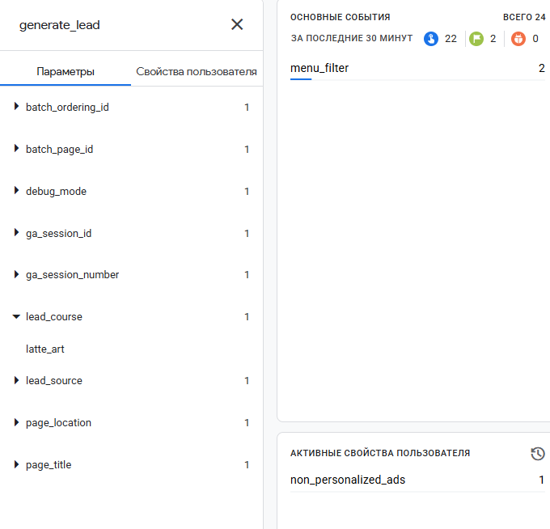
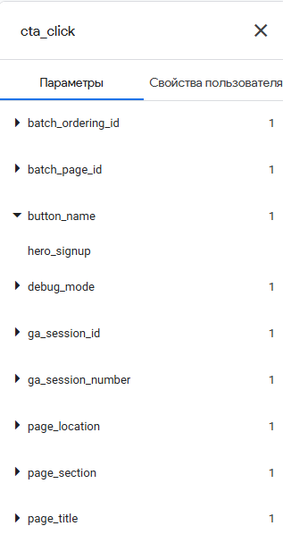
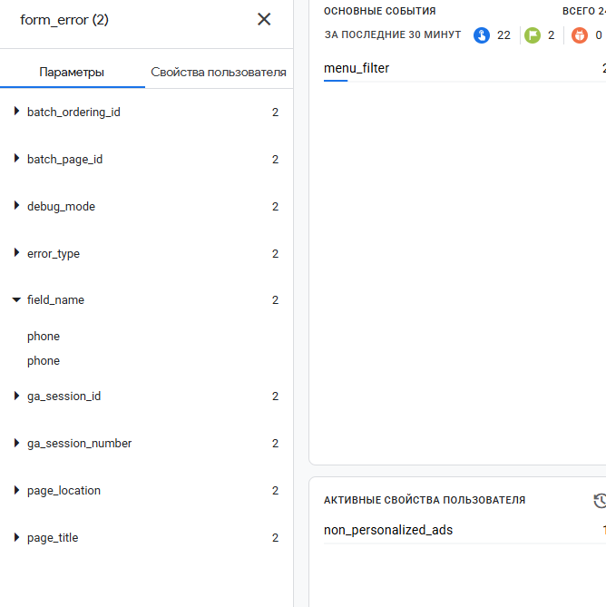
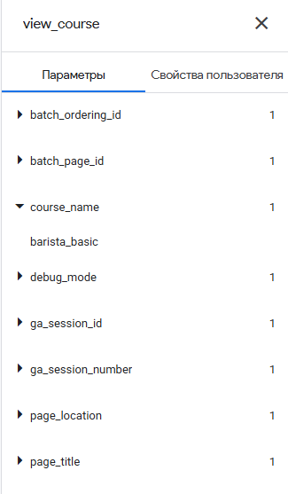

# Занятие 4. События и параметры Google Analytics 4

| Поле | Значение |
|---|---|
| Студент | Абдуллаев Билолиддин Низомидинович |
| Группа | 9/2-РПО-25/3 |
| Дисциплина | ОП.03 «Информационные технологии» |
| Работа | Домашняя работа № 4 |

На сайте «Зерно 7» настроено 20 событий. Полная таблица с номерами строк кода: [docs/events.md](../../tz-02-kofeynya-zerno7/docs/events.md). Все вызовы `gtag('event', …)` собраны в одной функции `track` в [js/analytics.js](../../tz-02-kofeynya-zerno7/js/analytics.js). Кнопки описаны атрибутами `data-event` в HTML.

## Автоматические события (расширенная статистика)

| Событие | Когда | Пример параметра |
|---|---|---|
| `page_view` | открытие страницы | page_title |
| `scroll` | прокрутка до 90 % | percent_scrolled: 90 |
| `click` | внешняя ссылка | link_url, outbound: true |
| `file_download` | скачивание PDF | file_name: /files/latte-guide.pdf |
| `form_start` / `form_submit` | работа с формой | form_id: lead-form |

## Свои события

| Событие | Ключевое | Пример параметров |
|---|---|---|
| `generate_lead` | да | lead_course: latte_art, lead_source: instagram |
| `contact_click` | да | contact_type: phone |
| `messenger_click` | да | messenger: telegram |
| `cta_click` | | button_name: hero_signup, page_section: hero |
| `view_course` | | course_name: barista_basic |
| `select_course_date` | | course_name, start_date: 2026-12-07 |
| `quiz_complete` | | quiz_result: barista_basic |
| `menu_filter` | | filter_value: lactose_free |
| `bean_view` | | bean_name: kenya_nyeri, roast_level: light |
| `promo_copy` | | promo_code: LATTE10 |
| `social_click` | | network: instagram |
| `form_error` | | field_name: phone, error_type: format |
| `map_open` | | map_service: yandex_maps |
| `gallery_view` | | photo_index: 3 |

Имя, телефон и e-mail в GA4 не передаются.

## Проверка в DebugView

Снимки остальных событий лежат в [screens/ga4/](../../tz-02-kofeynya-zerno7/screens/ga4/).
