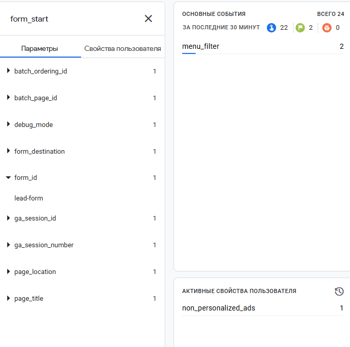
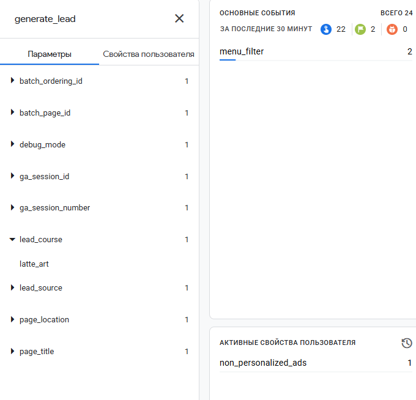

# Занятие 5. Приём заявок с сайта в Google Таблицы

| Поле | Значение |
|---|---|
| Студент | Абдуллаев Билолиддин Низомидинович |
| Группа | 9/2-РПО-25/3 |
| Дисциплина | ОП.03 «Информационные технологии» |
| Работа | Домашняя работа № 5 |

## Как устроен приём заявок

1. Пользователь заполняет форму на сайте ([js/form.js](../../tz-02-kofeynya-zerno7/js/form.js)). Форма проверяет поля, приводит телефон к формату +7 (`normalizePhone`) и берёт UTM-метки из адреса страницы или из sessionStorage (`readUtm`).
2. Форма отправляет данные через `fetch` на веб-приложение Google Apps Script ([apps-script/Code.gs](../../tz-02-kofeynya-zerno7/apps-script/Code.gs), функция `doPost`).
3. Скрипт проверяет данные, отклоняет повторный `request_id` (ответ `duplicate_request_id`) и дописывает строку в лист `leads`. Статус новой заявки всегда `new`.
4. После ответа `ok: true` сайт отправляет в GA4 событие `generate_lead`.

Таблица: [Zerno7 — Leads](https://docs.google.com/spreadsheets/d/1PVM_GEj12DnQ_oKWPihchwo72jw7Ts2gGPIHwIuBiLo/edit).

## Столбцы листа `leads`

`request_id`, `created_at`, `name`, `phone`, `email`, `course`, `start_month`, `utm_source`, `utm_medium`, `utm_campaign`, `utm_content`, `status`

Функция `setupSheet` создаёт заголовки, выпадающие списки (course, start_month, status) и подсветку: пустые обязательные ячейки жёлтым, повторный `request_id` красным.

## Проверка

- Пустой телефон → «Введите номер телефона», а «123» → «Номер в формате +7 и 10 цифр». В GA4 при этом приходит `form_error`.
- Повторная отправка с тем же `request_id` → `{ok: false, error: "duplicate_request_id"}`, новой строки нет.

## Сверка таблицы и GA4

В таблице 5 заявок, а `generate_lead` в GA4 6. Часть событий я отправлял вручную для проверки в DebugView, а одна строка таблицы — тест из редактора Apps Script (`testDoPost`), без события в GA4.
