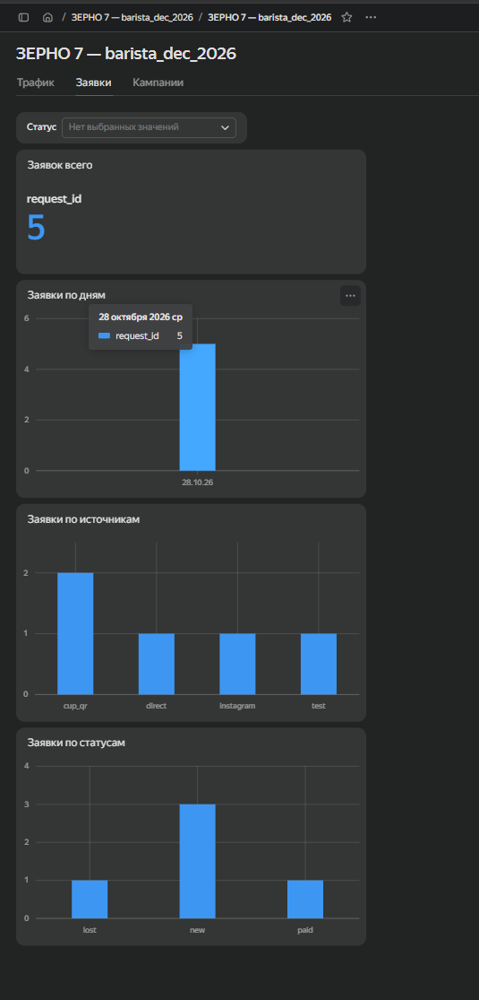

# Занятие 6. Очистка и подготовка данных в таблицах

| Поле | Значение |
|---|---|
| Студент | Абдуллаев Билолиддин Низомидинович |
| Группа | 9/2-РПО-25/3 |
| Дисциплина | ОП.03 «Информационные технологии» |
| Работа | Домашняя работа № 6 |

## 1. Чистые данные на входе

Чтобы в лист `leads` не попадал мусор, я проверяю данные ещё до записи:

| Проблема | Как решена | Где |
|---|---|---|
| Телефон в разных форматах | приводится к виду +7 и 10 цифр | `normalizePhone` в [js/form.js](../../tz-02-kofeynya-zerno7/js/form.js) |
| Пустые обязательные поля | форма не отправляется, в таблице пустые ячейки подсвечены жёлтым | `validate`, `setupSheet` |
| Повторная заявка | повторный `request_id` отклоняется и подсвечивается красным | `isDuplicate_` в [Code.gs](../../tz-02-kofeynya-zerno7/apps-script/Code.gs) |
| Произвольные значения курса и статуса | выпадающие списки | `setupSheet` |
| Длинные строки в UTM | обрезаются до 200 символов | `readUtm` |
| Подмена статуса из браузера | статус из запроса игнорируется, всегда `new` | `doPost` |

## 2. Подготовка выгрузки GA4

Данные из GA4 я выгрузил на листы `ga4_traffic` и `ga4_leads` и почистил:
- удалил служебные строки-комментарии и строку «Общий итог»;
- заменил `(direct)` → `direct`, `(not set)` → `not_set`, `(none)` → `none`, чтобы значения совпадали с тем, что пишет форма;

Готовые файлы: [ga4_traffic.csv](../../tz-02-kofeynya-zerno7/docs/reports/ga4_traffic.csv), [ga4_leads.csv](../../tz-02-kofeynya-zerno7/docs/reports/ga4_leads.csv).

## 3. Использование чистых данных

По очищенным листам построен дашборд DataLens: [ЗЕРНО 7 — barista_dec_2026](https://datalens.ru/nxavdwghggvk6-zerno-7-barista-dec-2026). Листы GA4 соединены с заявками по дате, источнику и кампании, а поля name, phone и email в датасете скрыты.

