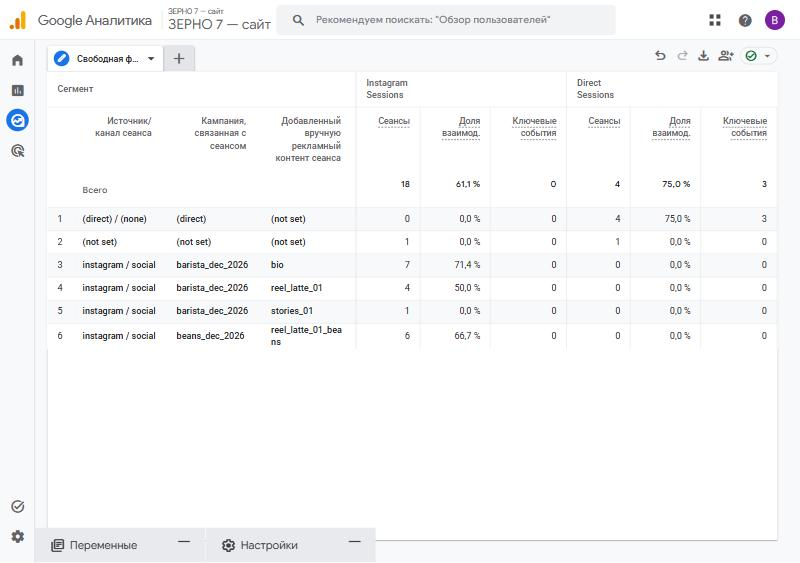
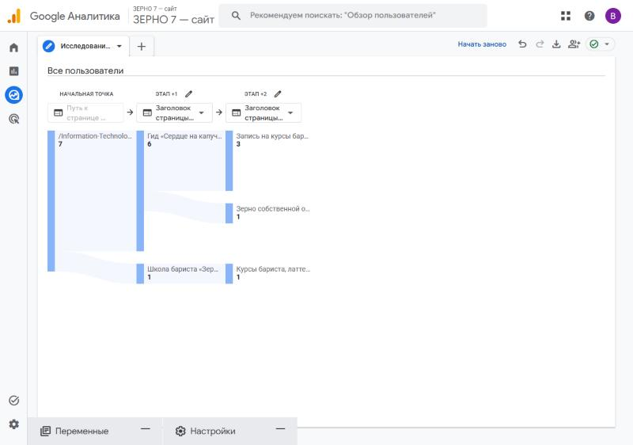

# Занятие 7. Instagram, ManyChat и путь заявки

| Поле | Значение |
|---|---|
| Студент | Абдуллаев Билолиддин Низомидинович |
| Группа | 9/2-РПО-25/3 |
| Дисциплина | ОП.03 «Информационные технологии» |
| Работа | Домашняя работа № 7 |

- Профиль Instagram: https://www.instagram.com/bilol.abd20092024/
- Reel «Сердце на капучино за 30 секунд»: https://www.instagram.com/reel/DfA71NUtl6I/

## Автоответы ManyChat

Под Reel настроены две ветки:

| Комментарий | Что отвечает ManyChat | Ссылка |
|---|---|---|
| **ЛАТТЕ** | ответ в комментариях и сообщение в Direct с пошаговым гидом и промокодом на курс латте-арта | U-02 → `latte-guide.html`, content `reel_latte_01` |
| **ЗЕРНО** | «Зерно, на котором мы снимали это видео, и ещё 5 сортов нашей обжарки — по кнопке ниже» + кнопка «Выбрать зерно» | U-03 → `beans.html`, кампания `beans_dec_2026` |

Тексты публикаций: [docs/posts.md](../../tz-02-kofeynya-zerno7/docs/posts.md).

## Путь заявки из Instagram

Комментарий «ЛАТТЕ» → сообщение в Direct → переход на сайт с UTM-метками → `page_view` → `cta_click` → форма → строка в листе `leads` с `utm_source = instagram` → `generate_lead` в GA4.

## Результаты (27–29.10.2026, данные тестовые)

- Instagram дал больше всего трафика: 18 сеансов из 34.
- Доля взаимодействия: Instagram 61,1 %, Direct 75,0 %.
- После гида по латте 3 человека из 7 перешли на запись на курсы.
- Заявок из Instagram за эти дни нет. Главная потеря — между просмотром страницы и кликом по кнопке записи.

Полная аналитическая записка: [docs/report.md](../../tz-02-kofeynya-zerno7/docs/report.md).
